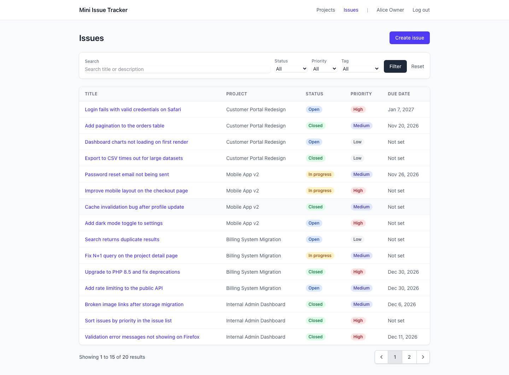
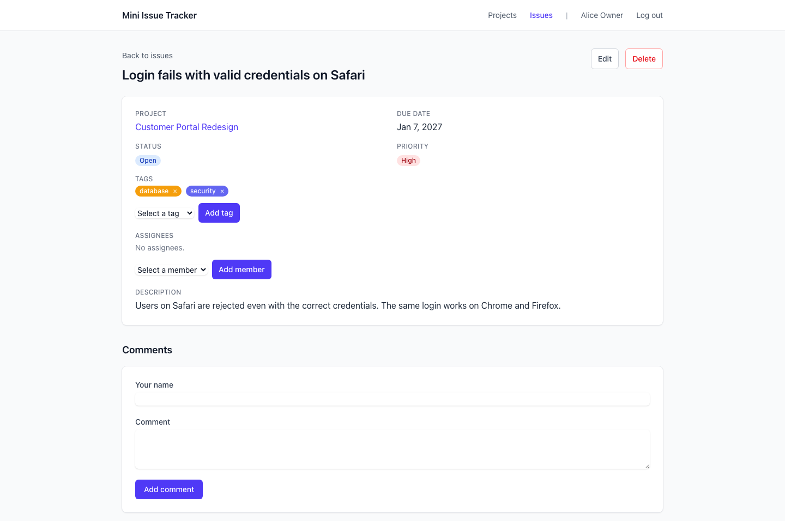
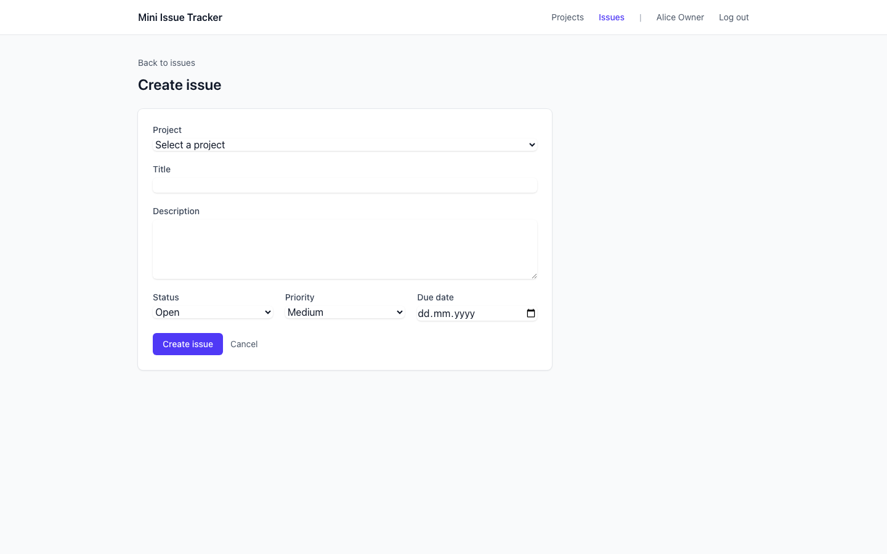

# Mini Issue Tracker

[](https://github.com/BregorAxhimusa/mini-issue-tracker/actions/workflows/tests.yml)

A small issue tracker built with Laravel and Blade: projects, issues, tags, assignees and comments, with server-rendered pages and a few inline interactions done with plain `fetch`.

## Features

- **Projects:** create, view, edit and delete, each with a name, description, start date and deadline. Only a project's owner can edit or delete it, enforced with a policy.
- **Issues:** create, view, edit and delete, with a status (open, in progress, closed), a priority (low, medium, high) and an optional due date.
- **Filtering and search:** filter the issue list by status, priority and tag, combined with a debounced text search over titles and descriptions. Results are paginated, 15 per page.
- **Tags:** attach and detach tags on an issue without a page reload.
- **Assignees:** add and remove multiple members per issue with the same inline interface.
- **Comments:** loaded on demand with pagination, new comments added inline, validation errors shown on the form.
- **Authentication:** Laravel Breeze (login, registration, password reset).

## Tech stack

- PHP 8.3+, Laravel 13, Blade
- Laravel Breeze for authentication
- Tailwind CSS 4 built with Vite
- Plain JavaScript `fetch` for the inline parts, no front-end framework
- MySQL or SQLite; the tests run on SQLite in memory
- PHPUnit, run on GitHub Actions

## Screenshots

Issue list with filters:



Issue detail with tags, assignees and comments:



Create issue form:



## Local setup

Requirements: PHP 8.3 or newer, Composer, Node.js with npm, and MySQL 8 or SQLite.

```bash
composer install
npm ci
npm run build
cp .env.example .env
php artisan key:generate
```

`.env.example` points at a MySQL database named `issue_tracker`. To use SQLite instead, set `DB_CONNECTION=sqlite` in `.env`, remove the other `DB_*` lines and create the file with `touch database/database.sqlite`.

Then create the tables, seed the demo data and start the app:

```bash
php artisan migrate --seed
php artisan serve
```

The app runs at http://127.0.0.1:8000 and the home page redirects to the projects list. Use `npm run dev` instead of `npm run build` for hot reloading.

## Demo login

The seeder creates two project owners, plus extra members, tags, projects and issues with comments. Every seeded user has the password `password`.

| Email | Password |
| --- | --- |
| alice@example.com | password |
| bob@example.com | password |

You can also register a new account from the login page.

## Running tests

```bash
npm run build
php artisan test
```

The views load the Vite manifest, so the assets must be built first. PHPUnit uses SQLite in memory, so no database setup is needed. The suite covers the Breeze authentication flows. The same steps run on every push in [`.github/workflows/tests.yml`](.github/workflows/tests.yml).

## License

[MIT](LICENSE)
